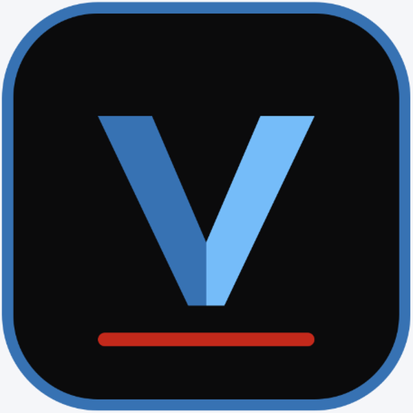
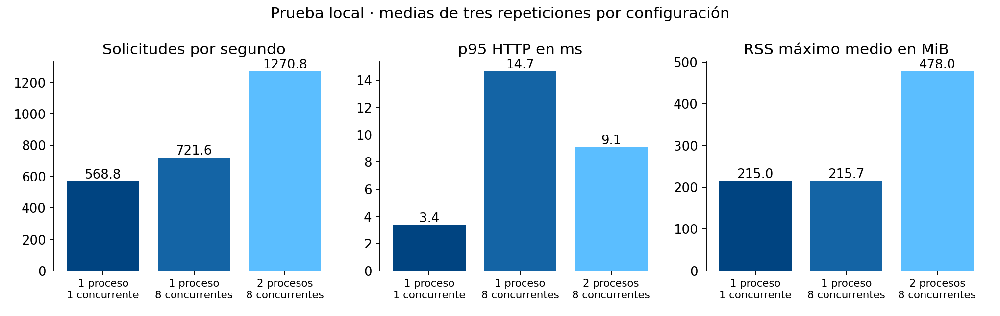
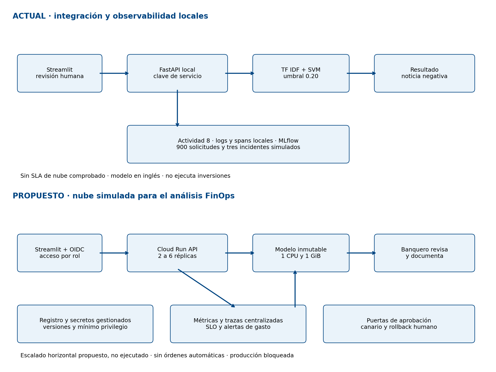

<p align="center"></p>

# Actividad 9 · Escalabilidad y gobernanza responsable

**Eduardo Aburto Angulo · Módulo 3 / Semana 11 · Temas 21 y 22**

Como banquero Sr., propongo escalar la preparación de revisiones de portafolio con costos transparentes, evidencia técnica y revisión humana. Esta entrega analiza el servicio heredado y propone su evolución; **la nube es un escenario simulado y la producción sigue bloqueada**.

## Empieza aquí

| Entregable | Consulta | Editable |
|---|---|---|
| Reporte técnico · 14 páginas | [PDF](documentos/Reporte_tecnico.pdf) | [Word](documentos/Reporte_tecnico.docx) |
| Anexo técnico · 8 páginas | [PDF](documentos/Anexo_tecnico.pdf) | [Word](documentos/Anexo_tecnico.docx) |
| Arquitectura actual y propuesta | [Imagen](documentos/Arquitectura.png) | [PDF](documentos/Arquitectura.pdf) |
| Tablero interactivo | [Streamlit](app.py) | Instrucciones abajo |
| Evidencia reproducible | [Resultados](evidencias) | [Scripts](scripts) |

**Google Docs:** [Reporte editable](https://docs.google.com/document/d/1cMp3WDCrJkl1x_W6ingDuwyoSVslExBId_ULa-wSJVs/edit) · [Anexo editable](https://docs.google.com/document/d/12Pbozhz5y7g3ldfxwKvP_1mU0_0ilrX4OxzmVmfxns4/edit)

## Qué demuestra la entrega

| Medido localmente | Estimado o propuesto |
|---|---|
| 40,680 solicitudes HTTP exitosas, nueve corridas | Rediseño Cloud Run de 2 a 6 réplicas |
| Predicciones conservadas con diferencia <1e-12 | Infraestructura estable USD 170.05/mes |
| Dos procesos: media 1,270.8 solicitudes/s y p95 9.08 ms | Ahorro de infraestructura 42.59 % frente a base simulada |
| 452 noticias: recall 0.8361, precisión 0.6711 | SLO 99.9 % mensual y p95 ≤250 ms, aún sin validación cloud |
| 11 pruebas automatizadas, incluido Streamlit | Cinco aprobaciones pendientes antes de producción |



**Lectura correcta:** dos procesos en un host no son escalado horizontal de nube. Las repeticiones duran 3.51–8.01 s; no prueban carga sostenida. El test contiene noticias en inglés; el modelo no predice rentabilidad, no valida español y no ejecuta inversiones. Fairness por longitud es exploratoria y no acredita equidad demográfica.

## Cobertura de rúbrica

| Criterio · 25 puntos cada uno | Reporte | Evidencia |
|---|---|---|
| Arquitectura y escalabilidad | pp. 4–7 | [Diagrama](documentos/Arquitectura.pdf), [benchmark](evidencias/benchmark.json) |
| Costos y desempeño con FinOps | pp. 7–9 | [Costos](evidencias/costos.json), [supuestos](config/costs.json), anexo pp. 4–5 |
| Auditoría ética, técnica y legal | pp. 10–11 | [Fairness](evidencias/fairness.json), licencia y controles |
| Plan integrado responsable | pp. 12–13 | [Puertas de aprobación](config/governance.json), [estado](evidencias/governance_gate.json) |



## Reproducir y explorar

Python 3.12. Desde la raíz del repositorio:

```bash
python -m venv .venv
source .venv/bin/activate
pip install -r requirements.txt
pytest pruebas -q
python scripts/verify.py
streamlit run app.py
```

En Windows, activar con `.venv\Scripts\activate`. Streamlit abre cinco vistas: desempeño, FinOps, fairness, gobernanza y entregables. Lee evidencia histórica; mover los controles sólo recalcula supuestos económicos. **Código incluido y probado, sin despliegue público de Streamlit contratado.**

Para repetir experimentos —sobrescribe resultados locales; conserva antes el commit—:

```bash
python scripts/benchmark.py
python scripts/analyze.py
python scripts/costs.py
python scripts/governance.py
python scripts/figures.py
python scripts/verify.py
```

El benchmark levanta y detiene su API local, usa una clave temporal y conexiones persistentes. No requiere credenciales cloud ni GitHub. El intento abortado por puertos efímeros del cliente queda documentado en [intentos_benchmark.json](evidencias/intentos_benchmark.json); no integra las métricas finales.

La reconstrucción editorial usa `scripts/build_reports.py`, la plantilla retenida y `python-docx`/`pandas`; se entregan los documentos finales para no exigir herramientas de conversión al evaluador. Las figuras se reproducen con Matplotlib. El flujo CI verifica datos y tablero, sin repetir carga ni modificar evidencia.

## Gobernanza y límites

- **No aprobado para producción:** licencia comercial, dominio México/español, privacidad/jurídico, carga/failover cloud y fairness demográfica pendientes.
- NIST AI RMF e ISO/IEC 42001 son referencias de trabajo; no se afirma certificación.
- Corpus heredado bajo CC BY-NC-SA 3.0: revisar [atribución y licencia](modelos/LICENSE_DATASET.txt) antes de reutilizar comercialmente datos o modelo derivado.
- Costos USD de Cloud Run instance-based us-central1, consultados 8 noviembre 2026. Provisiones de observabilidad/almacenamiento y mano de obra son supuestos. Sin egress, impuestos, licencias, soporte ni descuentos. [Fuente](https://cloud.google.com/run/pricing).
- Seis réplicas permanentes subirían infraestructura a USD 380.29: más que la base y que el presupuesto académico USD 300. No ocultamos este escenario.

## Continuidad del proyecto

[Actividad 4](https://github.com/eduardoaburtoa/motor-senales-nlp) → [Actividad 5](https://github.com/eduardoaburtoa/actividad5-mlflow-portafolios) → [Actividad 6](https://github.com/eduardoaburtoa/actividad6-evaluacion-portafolios) → [Fase II](https://github.com/eduardoaburtoa/fase2-despliegue-portafolios) → [Actividad 8](https://github.com/eduardoaburtoa/actividad8-observabilidad-portafolios) → **Actividad 9**.

Conservo la SVM calibrada y umbral 0.20; no reentreno ni ajusto con el test. La evidencia de incidentes de Actividad 8 permanece histórica: recuperación no significa haber cumplido su presupuesto de latencia.

Los [150 clientes ficticios](contexto/clientes_simulados.csv), de MXN 5–20 millones, mantienen la continuidad didáctica sin datos reales. No forman parte del entrenamiento ni de la auditoría de fairness. El 1 % de compra y 1 % de venta son supuestos académicos, no tarifas BBVA verificadas. Las fichas y comisiones heredadas requieren verificar serie y vigencia antes de cualquier uso real; [consulta de accesibilidad](evidencias/fuentes_fondos.json) no acredita exhaustividad del catálogo ni actualiza sus cargos.

Mi decisión es avanzar por etapas y mantener revisión humana: eficiencia económica y volumen de operaciones no justifican perjudicar el perfil o el rendimiento neto del cliente.
