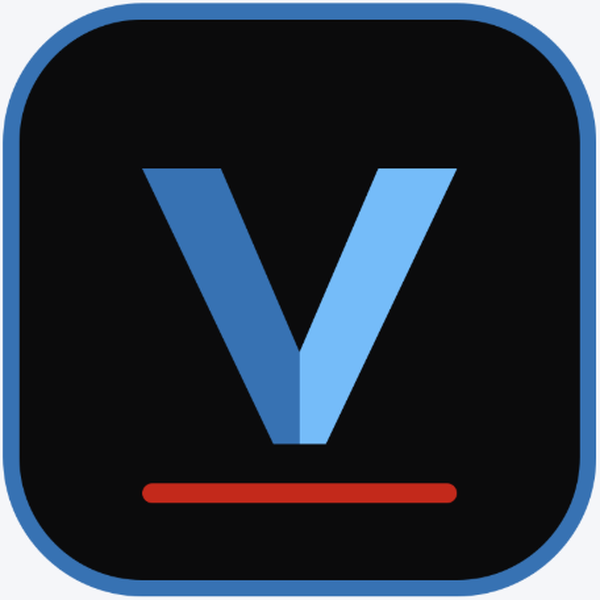
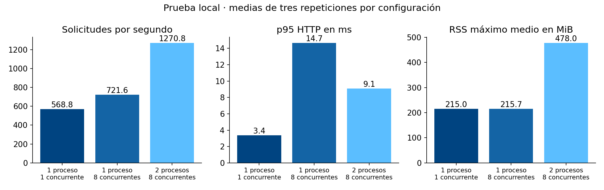
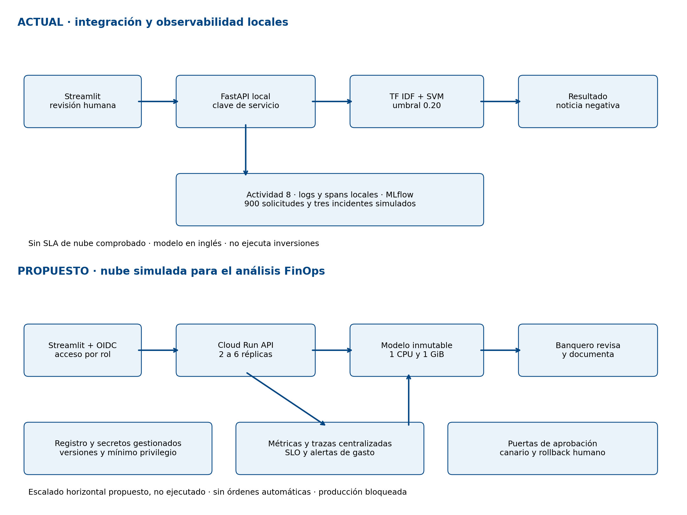
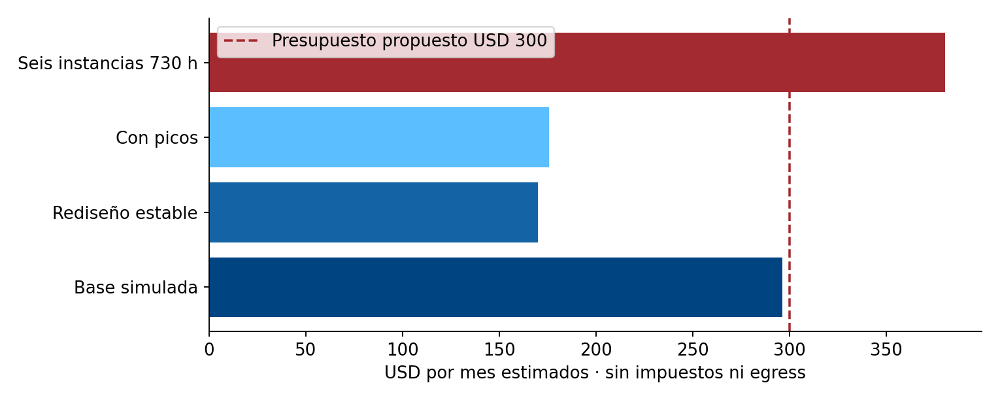
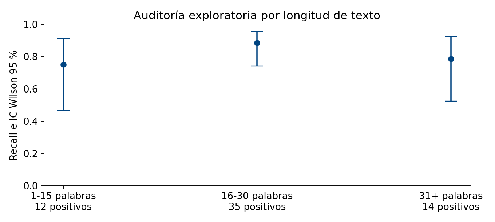

<p align="center"></p>
<h1 align="center">Actividad 9 · Escalabilidad y gobernanza responsable</h1>
<p align="center">Eduardo Aburto Angulo · Gestión de proyectos de inteligencia artificial<br>Módulo 3 · Semana 11 · Temas 21 y 22</p>

Como banquero Sr., propongo escalar la preparación de revisiones de portafolio con costos transparentes, evidencia técnica y revisión humana. Esta entrega analiza el servicio heredado y propone su evolución; **la nube es un escenario simulado y la producción sigue bloqueada**.

## Guía de entregables y resultados

**Presentación de la entrega · 22 de noviembre de 2026.**

[Objetivo](#objetivo) · [Resultados](#resultados) · [Arquitectura](#arquitectura) · [FinOps](#finops) · [Gobernanza](#gobernanza) · [Plan responsable](#plan) · [Rúbrica](#rubrica) · [Streamlit y reproducción](#reproducir) · [Mapa del repositorio](#mapa)

| Entregable | Lectura directa |
|---|---|
| Reporte técnico | [Escalabilidad, FinOps y gobernanza](documentos/01-reporte-tecnico/README.md) |
| Anexo técnico | [Costos, desempeño y fairness](documentos/02-anexo-tecnico/README.md) |
| Arquitectura | [Sistema actual y propuesto](documentos/03-arquitectura/README.md) |
| Tablero interactivo | [Streamlit](app.py), instrucciones de ejecución abajo |
| Evidencia reproducible | [Resultados](evidencias/README.md) · [Scripts](scripts/README.md) |
| Descargas y archivos editables | [Índice documental, PDF, Word y Excel](documentos/README.md) |

[**Explorar los entregables completos →**](documentos/README.md)

<details>
<summary>Documentos editables y descargas académicas</summary>

[Reporte en Google Docs](https://docs.google.com/document/d/1cMp3WDCrJkl1x_W6ingDuwyoSVslExBId_ULa-wSJVs/edit) · [Anexo en Google Docs](https://docs.google.com/document/d/12Pbozhz5y7g3ldfxwKvP_1mU0_0ilrX4OxzmVmfxns4/edit)

[Reporte PDF](documentos/Reporte_tecnico.pdf) · [Reporte Word](documentos/Reporte_tecnico.docx) · [Anexo PDF](documentos/Anexo_tecnico.pdf) · [Anexo Word](documentos/Anexo_tecnico.docx) · [Excel con fórmulas](documentos/Anexo_tecnico.xlsx) · [Arquitectura PDF](documentos/Arquitectura.pdf)

</details>

<a id="objetivo"></a>

## Objetivo y alcance de la actividad

Analizo cómo escalar una solución de inteligencia artificial y optimizar sus costos sin perder control sobre el servicio ni sobre sus riesgos. Integro dos dimensiones: **escalabilidad y FinOps**, y **gobernanza responsable**. Mi propuesta parte del servicio de clasificación de noticias de Fase II y de la observabilidad desarrollada en Actividad 8.

Desde mi perspectiva de banquero Sr., la utilidad está en preparar revisiones de portafolio con información trazable y supervisión humana. En esta actividad evalúo la infraestructura y sus controles: el clasificador no determina cambios de fondos ni promete mejores rendimientos.

La entrega reúne el diagnóstico de arquitectura, un rediseño propuesto, mediciones locales, costos estimados, auditoría ética/técnica/legal y un plan de escalamiento condicionado a aprobaciones. [Descripción y alcance completos](documentos/01-reporte-tecnico/README.md#seccion-3).

<a id="resultados"></a>

## Qué demuestra la entrega

| Medido localmente | Estimado o propuesto |
|---|---|
| 40,680 solicitudes HTTP exitosas, nueve corridas | Rediseño Cloud Run de 2 a 6 réplicas |
| Predicciones conservadas con diferencia <1e-12 | Infraestructura estable USD 170.05/mes |
| Dos procesos: media 1,270.8 solicitudes/s y p95 9.08 ms | Ahorro de infraestructura 42.59 % frente a base simulada |
| 452 noticias: recall 0.8361, precisión 0.6711 | SLO 99.9 % mensual y p95 ≤250 ms, aún sin validación cloud |
| 11 pruebas automatizadas, incluido Streamlit | Cinco aprobaciones pendientes antes de producción |



**Lectura correcta:** dos procesos en un host no son escalado horizontal de nube. Las repeticiones duran 3.51–8.01 s; no prueban carga sostenida. El test contiene noticias en inglés; el modelo no predice rentabilidad, no valida español y no ejecuta inversiones. Fairness por longitud es exploratoria y no acredita equidad demográfica.

<a id="arquitectura"></a>

## Arquitectura actual y rediseño propuesto

El servicio actual conserva la SVM calibrada y su umbral de decisión de 0.20. La propuesta separa la presentación, la API de inferencia y los controles operativos; plantea Cloud Run con capacidad ajustable y gobernanza previa al paso a producción.

| Dimensión | Diagnóstico y decisión | Desarrollo completo |
|---|---|---|
| Arquitectura actual | Servicio heredado, inferencia local y evidencia versionada | [Diagnóstico](documentos/01-reporte-tecnico/README.md#seccion-4) |
| Escalabilidad vertical | Evaluar recursos por instancia y sus límites | [Vertical y horizontal](documentos/01-reporte-tecnico/README.md#seccion-7) |
| Escalabilidad horizontal | Proponer réplicas cloud; validar carga y failover antes de autorizar | [Capacidad e inferencia](documentos/01-reporte-tecnico/README.md#seccion-8) |
| Integridad del modelo | Mantener predicciones y distinguir optimización de reentrenamiento | [Resultados y recursos](documentos/02-anexo-tecnico/README.md#seccion-5) |



[Ver el diagrama y sus límites](documentos/03-arquitectura/README.md) · [Configuración propuesta](config/deployment_propuesto.json)

<a id="finops"></a>

## Costos, desempeño y decisiones FinOps

El escenario estable estima **USD 170.05 mensuales de infraestructura**, con **42.59 % de ahorro** frente a la base simulada. Mantener seis réplicas permanentemente elevaría el costo a **USD 380.29**, por encima del presupuesto académico de USD 300. Por ello, el ahorro depende de la capacidad realmente necesaria y de las horas de uso; no es una garantía de factura.



| Evidencia | Consulta directa |
|---|---|
| Latencia p50, p95 y p99 | [Anexo de latencia](documentos/02-anexo-tecnico/README.md#seccion-6) |
| Throughput | [Solicitudes por segundo](documentos/02-anexo-tecnico/README.md#seccion-7) |
| Uso de CPU y memoria | [Recursos](documentos/02-anexo-tecnico/README.md#seccion-8) |
| Costos y sensibilidad | [Análisis FinOps](documentos/02-anexo-tecnico/README.md#seccion-9) · [Excel](documentos/Anexo_tecnico.xlsx) |
| Supuestos y resultados | [Configuración](config/costs.json) · [Cálculo exportado](evidencias/costos.json) · [Benchmark](evidencias/benchmark.json) |

Los precios son referencias consultadas el 8 de noviembre de 2026; esta edición de la portada no actualiza tarifas ni ejecuta nuevas mediciones. El presupuesto de infraestructura NLP no equivale al costo integral del proyecto.

<a id="gobernanza"></a>

## Auditoría ética, técnica y legal

La auditoría examina el alcance del modelo, los sesgos que pueden observarse, la procedencia de los datos, la licencia y los controles necesarios antes de un uso productivo. **La producción permanece bloqueada**: los resultados locales no sustituyen las aprobaciones pendientes.



| Frente de revisión | Hallazgo o condición | Evidencia |
|---|---|---|
| Calidad y sesgos | El análisis por longitud textual es exploratorio; no acredita equidad demográfica | [Fairness por grupo](documentos/01-reporte-tecnico/README.md#seccion-16) · [Resultados](evidencias/fairness.json) |
| Dominio de aplicación | Noticias en inglés; falta validar el dominio México/español | [Auditoría técnica](documentos/01-reporte-tecnico/README.md#seccion-14) |
| Licencia y privacidad | Revisión comercial y jurídica pendiente antes de producción | [Auditoría ética y legal](documentos/01-reporte-tecnico/README.md#seccion-17) · [Licencia](modelos/LICENSE_DATASET.txt) |
| Trazabilidad | Modelo, evidencia y decisiones identificables | [Manifiesto](modelos/manifest.json) · [Procedencia](evidencias/procedencia.json) |
| Control humano | Sin ejecución automática de inversiones ni autorización productiva implícita | [Controles](config/governance.json) · [Estado de aprobación](evidencias/governance_gate.json) |

<a id="plan"></a>

## Plan de escalamiento responsable

Mi decisión es avanzar por etapas: conservar una base reproducible, validar capacidad y costos en la nube, resolver las revisiones de dominio y licencia, y comprobar los controles antes de autorizar producción. Las cinco aprobaciones pendientes son: **licencia comercial, dominio México/español, privacidad/jurídico, carga y failover cloud, y fairness demográfica**.

El SLO propuesto de 99.9 % mensual y p95 ≤250 ms es un objetivo por validar en cloud. El desempeño de un ensayo local corto no demuestra su cumplimiento. [Plan completo y responsables](documentos/01-reporte-tecnico/README.md#seccion-20) · [Conclusiones e impacto de negocio](documentos/01-reporte-tecnico/README.md#seccion-21).

<a id="rubrica"></a>

## Cobertura de la rúbrica

| Criterio · 25 puntos cada uno | Desarrollo en la entrega | Evidencia verificable |
|---|---|---|
| Arquitectura y escalabilidad | [Diagnóstico y rediseño](documentos/01-reporte-tecnico/README.md#seccion-4) | [Diagrama](documentos/03-arquitectura/README.md) · [Benchmark](evidencias/benchmark.json) |
| Costos y desempeño con FinOps | [Costos y decisiones](documentos/01-reporte-tecnico/README.md#seccion-10) | [Anexo de costos](documentos/02-anexo-tecnico/README.md#seccion-9) · [Excel](documentos/Anexo_tecnico.xlsx) |
| Auditoría ética, técnica y legal | [Auditoría y sesgos](documentos/01-reporte-tecnico/README.md#seccion-14) | [Fairness](evidencias/fairness.json) · [Controles](config/governance.json) |
| Plan integrado responsable | [Plan de escalamiento](documentos/01-reporte-tecnico/README.md#seccion-20) | [Puertas de aprobación](evidencias/governance_gate.json) |

[Índice completo del reporte](documentos/01-reporte-tecnico/README.md#contenido) · [Índice completo del anexo](documentos/02-anexo-tecnico/README.md#contenido)

<a id="reproducir"></a>

## Reproducir y explorar

Python 3.12. Desde la raíz del repositorio:

```bash
python -m venv .venv
source .venv/bin/activate
pip install -r requirements.txt
pytest pruebas -q
python scripts/verify.py
python scripts/validate_delivery.py
python scripts/verify_documentation.py
streamlit run app.py
```

En Windows, activar con `.venv\Scripts\activate`. Streamlit abre cinco vistas: desempeño, FinOps, fairness, gobernanza y entregables. Lee evidencia histórica; mover los controles sólo recalcula supuestos económicos. **Código incluido y probado, sin despliegue público de Streamlit contratado.**

Para repetir experimentos —sobrescribe resultados locales; conserva antes el commit—:

```bash
python scripts/benchmark.py
python scripts/analyze.py
python scripts/costs.py
python scripts/governance.py
python scripts/figures.py
python scripts/verify.py
```

El benchmark levanta y detiene su API local, usa una clave temporal y conexiones persistentes. No requiere credenciales cloud ni GitHub. El intento abortado por puertos efímeros del cliente queda documentado en [intentos_benchmark.json](evidencias/intentos_benchmark.json); no integra las métricas finales.

La reconstrucción editorial usa `scripts/build_reports.py`, la plantilla retenida y `python-docx`/`pandas`; se entregan los documentos finales para no exigir herramientas de conversión al evaluador. Las figuras se reproducen con Matplotlib. El flujo CI verifica datos y tablero, sin repetir carga ni modificar evidencia.

## Gobernanza y límites

- **No aprobado para producción:** licencia comercial, dominio México/español, privacidad/jurídico, carga/failover cloud y fairness demográfica pendientes.
- NIST AI RMF e ISO/IEC 42001 son referencias de trabajo; no se afirma certificación.
- Corpus heredado bajo CC BY-NC-SA 3.0: revisar [atribución y licencia](modelos/LICENSE_DATASET.txt) antes de reutilizar comercialmente datos o modelo derivado.
- Costos USD de Cloud Run instance-based us-central1, consultados 8 noviembre 2026. Provisiones de observabilidad/almacenamiento y mano de obra son supuestos. Sin egress, impuestos, licencias, soporte ni descuentos. [Fuente](https://cloud.google.com/run/pricing).
- Seis réplicas permanentes subirían infraestructura a USD 380.29: más que la base y que el presupuesto académico USD 300. No ocultamos este escenario.

## Continuidad del proyecto

[Fase I · business case](documentos/FaseI_contexto.md) → [Actividad 4](https://github.com/eduardoaburtoa/motor-senales-nlp) → [Actividad 5](https://github.com/eduardoaburtoa/actividad5-mlflow-portafolios) → [Actividad 6](https://github.com/eduardoaburtoa/actividad6-evaluacion-portafolios) → [Fase II](https://github.com/eduardoaburtoa/fase2-despliegue-portafolios) → [Actividad 8](https://github.com/eduardoaburtoa/actividad8-observabilidad-portafolios) → **Actividad 9**.

La Fase I definió el business case, el ROI esperado y el alcance de 3,600 clientes. No hay una Actividad 7 publicada en la cadena consultada; no atribuyo una razón que no está documentada. Fase II se conserva con su nombre de entrega y no se renombra como Actividad 7.

Conservo la SVM calibrada y umbral 0.20; no reentreno ni ajusto con el test. La evidencia de incidentes de Actividad 8 permanece histórica: recuperación no significa haber cumplido su presupuesto de latencia.

Los [150 clientes ficticios](contexto/clientes_simulados.csv), de MXN 5–20 millones, mantienen la continuidad didáctica sin datos reales. No forman parte del entrenamiento ni de la auditoría de fairness. El 1 % de compra y 1 % de venta son supuestos académicos, no tarifas BBVA verificadas. Las fichas y comisiones heredadas requieren verificar serie y vigencia antes de cualquier uso real; [consulta de accesibilidad](evidencias/fuentes_fondos.json) no acredita exhaustividad del catálogo ni actualiza sus cargos.

Mi decisión es avanzar por etapas y mantener revisión humana: eficiencia económica y volumen de operaciones no justifican perjudicar el perfil o el rendimiento neto del cliente.

## Alcance económico de Fase I

24 asesores × 150 clientes: 3,600 clientes evaluados diariamente, aproximadamente 108,000 evaluaciones en treinta días bajo una inferencia por evaluación. Los escenarios 100 mil, un millón y cinco millones representan referencia inicial, crecimiento regional (~9.26 veces) y techo hipotético (~46.30 veces). No demuestran capacidad cloud. [Cálculo y FIX fechado](evidencias/negocio_fase1.json) · [Cifras originales del autor](config/fase1.json). La infraestructura NLP es sólo un componente del presupuesto integral; esta actividad no valida el ROI de Fase I.

**La IA no sustituye el criterio del banquero; lo aumenta.**

## Revisión final 1.1.0

[Detalle de las siete ramas, pruebas y cambios](documentos/Revision_final.md) · [Conteo antes/después e integridad](evidencias/revision_editorial.json) · [Validación de fórmulas](evidencias/validacion_xlsx.json). Los Google Docs conservan sus enlaces y se comprobaron en incógnito con acceso de lector; sólo su propietario conserva edición.


## Revisión e integridad del repositorio

Cada carpeta incluye una guía de uso. El [inventario de revisión](evidencias/revision_2026_11_21.json) identifica los archivos originales mediante SHA-256. Revisar un archivo hoy no cambia la fecha de su experimento: modelos, datos, mediciones y tarifas conservan su procedencia.


<a id="mapa"></a>

## Organización y accesos del repositorio

| Carpeta | Contenido |
|---|---|
| [Documentos](documentos/README.md) | Reporte, anexo, arquitectura y descargas académicas |
| [Evidencias](evidencias/README.md) | Mediciones, gráficos, costos y trazabilidad |
| [Configuración](config/README.md) | Supuestos FinOps, despliegue y gobernanza |
| [API](backend/README.md) | Servicio de inferencia |
| [Modelos](modelos/README.md) | Artefacto, manifiesto y licencia |
| [Datos](datos/README.md) | Predicciones del test heredado |
| [Scripts](scripts/README.md) | Reproducción y verificación |
| [Pruebas](pruebas/README.md) | Controles automatizados y tablero |
| [Contexto](contexto/README.md) | Clientes ficticios y antecedentes didácticos |

[Validación automática](https://github.com/eduardoaburtoa/actividad9-escalabilidad-gobernanza/actions) · [Historial de cambios](CHANGELOG.md) · [Ramas del proyecto](https://github.com/eduardoaburtoa/actividad9-escalabilidad-gobernanza/branches) · [Volver al inicio](#objetivo)
