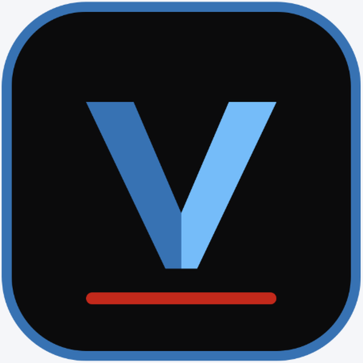
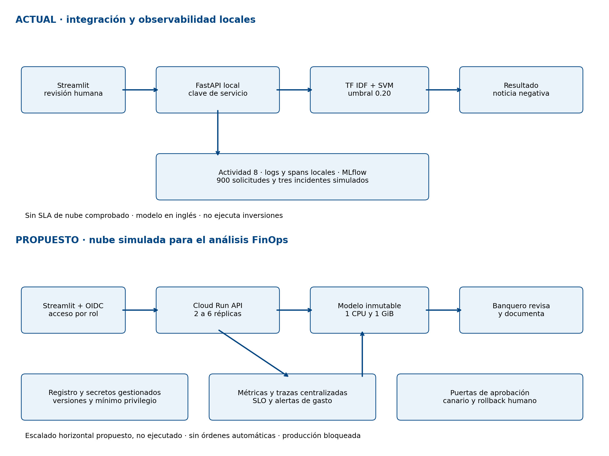
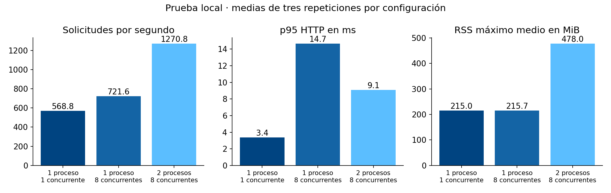
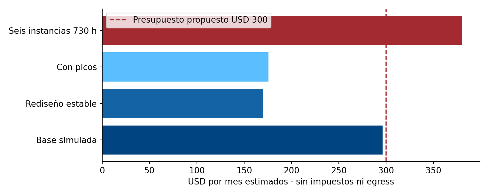
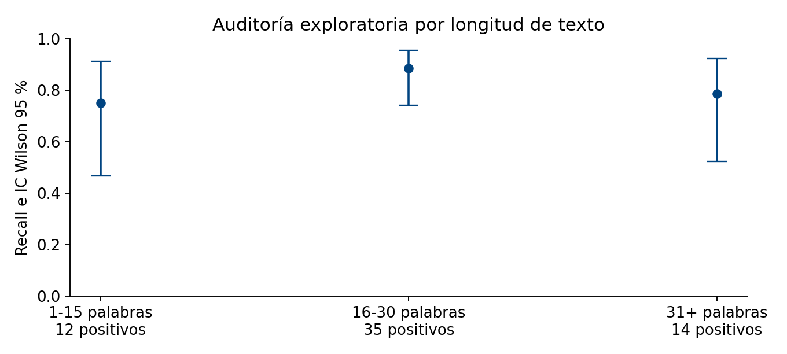

# Reporte técnico · Escalabilidad y gobernanza

**Eduardo Aburto Angulo · Actividad 9**

[Portada](../../README.md) · [Índice documental](../README.md)

Edición de lectura revisada el 21 de noviembre de 2026. Las mediciones y tarifas conservan la fecha y alcance de la evidencia original; esta revisión no constituye una nueva corrida.

## Contenido

- [Declaración de Uso de Inteligencia Artificial](#seccion-1)
- [Desarrollo de Contenido](#seccion-2)
- [Decisión y alcance](#seccion-3)
- [Arquitectura actual y diagnóstico](#seccion-4)
- [Sistema actual y sistema propuesto](#seccion-5)
- [Rediseño de escalabilidad e inferencia](#seccion-6)
- [Escalabilidad vertical y horizontal](#seccion-7)
- [Decisiones de capacidad e inferencia](#seccion-8)
- [Desempeño medido y objetivos de servicio](#seccion-9)
- [Costos y decisiones FinOps](#seccion-10)
- [Vinculación con el caso de negocio](#seccion-11)
- [Fase I y dimensionamiento del negocio](#seccion-12)
- [Control de gasto y sostenibilidad](#seccion-13)
- [Auditoría técnica y de sesgos](#seccion-14)
- [Fairness e incertidumbre](#seccion-15)
- [Evaluación de fairness por grupo](#seccion-16)
- [Auditoría ética legal y de seguridad](#seccion-17)
- [Marcos y controles aplicados](#seccion-18)
- [Controles y marcos de gobernanza](#seccion-19)
- [Plan de escalamiento responsable](#seccion-20)
- [Impacto de negocio y conclusiones](#seccion-21)
- [Cobertura de la rúbrica](#seccion-22)
- [Referencias](#seccion-23)

ACTIVIDAD 9

Escalabilidad y gobernanza responsable del asistente de portafolios

Vértice AI Consulting  ·  Convertimos datos en decisiones

| Materia: | Gestión de Proyectos de Inteligencia Artificial |
| --- | --- |
| Actividad: | Actividad 9 · Módulo 3 / Semana 11 · Temas 21 y 22 |
| Alumno(a): | Eduardo Aburto Angulo |
| Matrícula: | AL07182743 |
| Docente: | M. en C. Luis Ariel Vázquez Piña |
| Fecha de entrega: | 8 de noviembre de 2026 |

## Declaración de Uso de Inteligencia Artificial

El alumno debe indicar de manera honesta si utilizó herramientas de Inteligencia Artificial (IA) para el desarrollo de esta actividad. Completa la siguiente tabla:

| Herramienta de IA utilizada | ¿La usaste? | Propósito / Descripción de uso |
| --- | --- | --- |
| ChatGPT / OpenAI | Sí | ChatGPT/Codex: apoyo en programación, pruebas locales, investigación de fuentes públicas, documentación y revisión visual. Distingo mediciones reales de escenarios y propuestas. |
| Claude (Anthropic) | Sí | Revisión técnica independiente de la entrega: clonado del repositorio, ejecución propia de las 11 pruebas automatizadas y de `scripts/verify.py` —que confirma el modelo conservado, las 40,680 solicitudes, las nueve mediciones y el bloqueo productivo—; verificación del SHA256 del modelo contra el manifiesto y la cadena Actividad 6 → Fase II → Actividad 8; cotejo de los entregables contra los cuatro criterios de la rúbrica y los apartados exigidos; y elaboración de las instrucciones de corrección. No redactó el código ni los documentos. |
| Gemini (Google) | No | No utilizada en la ejecución de la Actividad 9. |
| Copilot (Microsoft) | No | No utilizada en la ejecución de la Actividad 9. |
| Otra (especifica): | No | No utilizada en la ejecución de la Actividad 9. |

## Desarrollo de Contenido

## Decisión y alcance

Propongo escalar el servicio de clasificación de noticias con réplicas pequeñas y conservar una aprobación humana antes de cualquier decisión de inversión. El análisis estima una reducción de 42.59 % en infraestructura frente a una base cloud simulada. La prueba HTTP local procesó 40,680 solicitudes sin errores y mantuvo las predicciones; estos resultados no acreditan disponibilidad mensual ni capacidad en nube.

Desde mi enfoque de banquero Sr., la eficiencia sólo tiene valor si mejora la preparación de la revisión y protege al cliente. Por ello, mi decisión es continuar en un entorno académico. El uso productivo permanece bloqueado hasta resolver licenciamiento, validación en español y México, privacidad, pruebas cloud y evidencia de fairness demográfica.

Mi cadena empieza en Fase I: business case, ROI esperado y alcance de 3,600 clientes. Sigue por Actividad 4, Actividad 5, Actividad 6, Fase II, Actividad 8 y Actividad 9. No consta una Actividad 7 publicada en esta cadena; no invento el motivo ni renombro Fase II. Doy continuidad a la SVM calibrada de Actividades 5 y 6, a la API de Fase II y a los aprendizajes operativos de Actividad 8. No vuelvo a entrenar ni a seleccionar el modelo con el test. La clase positiva identifica noticia negativa en inglés; no predice rendimientos ni recomienda comprar o vender fondos.

| Entregable | Contenido verificable |
| --- | --- |
| Reporte técnico | Arquitectura, rediseño, FinOps, auditoría y plan de aprobación |
| Anexo técnico | Nueve corridas HTTP, costos, calidad y brechas por longitud |
| Arquitectura PNG y PDF | Estado local actual y nube propuesta claramente separados |
| Repositorio y Streamlit | Scripts, configuraciones, datos de evidencia y exploración de resultados |

## Arquitectura actual y diagnóstico

El sistema integra Streamlit, FastAPI y un pipeline TF IDF con SVM calibrada. La API verifica la integridad del archivo de modelo y exige una clave de servicio; expone salud, descripción del modelo e inferencia. Fase II comprobó integración y contenedorización local. No atribuyo a ese antecedente un despliegue cloud público que no consta en la evidencia.

Actividad 8 añadió métricas, logs, spans locales y registro en MLflow. Sus 900 solicitudes incluyeron tres incidentes inyectados: se recuperó la operación, pero 120 solicitudes lentas excedieron el presupuesto de nueve. Recuperarse no borra el incumplimiento. Esta entrega añade un benchmark sano; no reemplaza ni altera esa evidencia histórica.

| Limitación actual | Consecuencia | Decisión |
| --- | --- | --- |
| Proceso y almacenamiento locales | Un host concentra falla y estado | Separar servicio sin estado de evidencia persistente |
| Clave estática de laboratorio | Rotación y autorización limitadas | Proponer OIDC, identidad de servicio y secretos gestionados |
| Spans locales | Sin correlación distribuida comprobada | Proponer colector y trazabilidad centralizada |
| Noticias en inglés y corpus histórico | Dominio mexicano sin validar | Bloquear recomendación financiera y expansión productiva |
| Sin factura ni carga cloud | No hay costo ni SLA observado en nube | Costeo por escenario y ensayo cloud como puerta futura |

La versión de Fase II usada como antecedente es b6ecb7a0e6b01ece989369b7b67178fe7d7cc2a4. El modelo conserva SHA256 f48c7496d5a12bd15d535721e3e83c6ef895b1ae7eaccbe7f4f4c60705bb1916 y umbral 0.20.

## Sistema actual y sistema propuesto

Figura 1. Arquitectura propia. El bloque superior representa antecedentes locales; el inferior es una propuesta no desplegada.

Conservaría el artefacto inmutable y su versión en cada resultado. El flujo termina en revisión documentada del banquero. La arquitectura no contiene un enlace que ejecute órdenes de inversión.

## Rediseño de escalabilidad e inferencia

## Escalabilidad vertical y horizontal

| Dimensión | Qué cambia y límite | Costo y evidencia | Mi decisión |
| --- | --- | --- | --- |
| Escalabilidad vertical | CPU y RAM de una réplica. Límite: cuota máxima, memoria y paralelismo aprovechable. | Rightsizing simulado de 2 CPU/4 GiB a 1 CPU/1 GiB: API USD 231.26 a 105.12/mes; infraestructura USD 296.20 a 170.05. | Reducir tamaño sólo después de probar carga y memoria con cuotas reales. |
| Escalabilidad horizontal | Número de réplicas independientes. Límite: coordinación, cuotas, cola y presupuesto. | Dos procesos locales alcanzan media 1,270.8 rps y p95 medio 9.08 ms; esto sólo evidencia paralelismo intrahost. | Proponer 2 a 6 réplicas pequeñas en Cloud Run: crecer por unidades y tolerar pérdida de una réplica. |

Elijo escalabilidad horizontal para ajustar capacidad por demanda sin concentrarla en una única instancia. Una réplica adicional tiene costo incremental y puede aislar un fallo de proceso; no garantiza tolerancia regional. Mantengo el eje vertical como ajuste del tamaño por réplica y no como sustituto de redundancia.

Dos procesos en un host no son escalado horizontal de nube. Las repeticiones de 3.51 a 8.01 segundos no prueban carga sostenida. El cambio vertical es un escenario económico, no una comparación experimental con límites de CPU y RAM impuestos. La decisión debe confirmarse en el ensayo cloud antes del piloto.

## Decisiones de capacidad e inferencia

| Decisión | Justificación y límite |
| --- | --- |
| Escalado vertical | Evaluar 1 frente a 2 CPU y 1 frente a 2 GiB por réplica en nube. Más RAM no acelera necesariamente TF IDF. El ensayo local de dos procesos no impone cuotas cloud. |
| Escalado horizontal | Proponer Cloud Run con dos réplicas mínimas y seis máximas, concurrencia inicial ocho. Réplicas sin estado, revisiones versionadas y rollback. No se midió autoscaling real. |
| Disponibilidad | Dos réplicas reducen dependencia de un proceso, pero no acreditan tolerancia regional. Probar pérdida de réplica y restauración; documentar dependencia del proveedor. |
| Inferencia | Cargar una vez el modelo; conexiones persistentes; lotes offline de hasta 128. Mantener ruta interactiva sin espera de lote. |
| Cache | Sólo textos públicos con clave hash de texto, versión y umbral. TTL propuesto 15 min; medir hit rate. No implementada ni incluida en ahorro. |
| Optimización descartada | No usar GPU, poda ni cuantización por moda: este modelo pequeño no tiene beneficio demostrado y debe conservar sus predicciones. |

Cloud Run considera CPU y concurrencia para autoscaling; la utilización de memoria requiere vigilancia propia. Una aplicación que no aproveche varias CPU puede quedar mal dimensionada si se observa sólo su promedio. Probaría una CPU por réplica antes de ampliar verticalmente. El máximo de instancias limita expansión, pero puede generar cola y rechazos; no es una garantía exacta de gasto (Google Cloud, s. f.).

En lotes offline, tamaño 128 obtuvo alrededor de 29 mil textos por segundo frente a 1.19 mil con tamaño uno, sin cambios de probabilidad. Es tiempo amortizado sin HTTP; no equivale a latencia p95 de un usuario. No traslado esa aceleración al cálculo del SLA.

## Desempeño medido y objetivos de servicio

Figura 2. Medias de tres repeticiones por configuración. Fuente: benchmark HTTP local reproducible.

| Procesos / concurrencia | Solicitudes por segundo | p95 medio ms | RSS medio MiB |
| --- | --- | --- | --- |
| 1 / 1 | 568.8 | 3.38 | 215.0 |
| 1 / 8 | 721.6 | 14.67 | 215.7 |
| 2 / 8 | 1270.8 | 9.08 | 478.0 |

Cada repetición ejecutó 4,520 solicitudes sobre las mismas 452 noticias; duró entre 3.51 y 8.01 segundos. El host ARM dispone de diez CPU lógicas y 16 GiB. Cliente y servidor comparten equipo, la carga es cerrada y se excluyen veinte warmups por configuración. No medí WAN, cold starts, sostenimiento por una hora ni fallas de infraestructura. RSS suma procesos y puede duplicar páginas compartidas.

Defino como objetivos propuestos disponibilidad mensual de 99.9 % y p95 ≤250 ms a diez solicitudes por segundo. El presupuesto temporal es 43.2 minutos en treinta días. Es un SLO de diseño, no un SLA contractual demostrado. Antes de aprobar el piloto exigiré una hora de carga, ráfagas, pérdida de réplica y medición desde otra máquina; el SLA formal deberá acordarse con negocio y proveedor.

## Costos y decisiones FinOps

Figura 3. Infraestructura mensual estimada en USD. El escenario máximo supera el presupuesto propuesto.

| Escenario | Infra USD | TCO USD | Ahorro infra |
| --- | --- | --- | --- |
| Base cloud simulada | 296.20 | 616.20 | 0.00 % |
| Rediseño estable | 170.05 | 490.05 | 42.59 % |
| Rediseño con picos | 175.81 | 495.81 | 40.64 % |
| Límite seis instancias todo el mes | 380.29 | 700.29 | -28.39 % |

El costo usa 730 horas y tarifas on demand instance based de Cloud Run us central1: USD 0.000018 por vCPU segundo y 0.000002 por GiB segundo, consultadas el 8 de noviembre de 2026. Comparo una base simulada de dos instancias con dos CPU y cuatro GiB contra dos instancias de una CPU y un GiB. No son facturas de la entrega anterior.

Mantengo un frontend de USD 49.93, provisiones académicas de USD 10 para observabilidad y 5 para almacenamiento. El TCO agrega ocho horas de trabajo a USD 40. Excluyo impuestos, egress, licencias, soporte y balanceador externo; no aplico free tier ni descuentos. Estos conceptos deben cotizarse antes de contratar. Con un millón de solicitudes, el costo unitario de infraestructura estable es USD 0.1701 por mil; ese denominador no acredita capacidad.

## Vinculación con el caso de negocio

## Fase I y dimensionamiento del negocio

La Fase I aporta el business case: 24 asesores con 150 clientes cada uno, 3,600 clientes y AUM simulado de $54,397 millones MXN. Preserva 7,200 revisiones al año y evaluación diaria de la cartera. Copio estas cifras del antecedente proporcionado por el autor; no recalculo su ROI.

Bajo treinta días y una inferencia por evaluación, dimensiono 108,000 evaluaciones mensuales. Una evaluación de cartera puede requerir varias noticias, o compartir noticias entre clientes: esa relación debe medirse en el piloto. Las revisiones anuales son un proceso humano distinto y no se suman como inferencias.

| Escenario de solicitudes | Relación con Fase I | Uso |
| --- | --- | --- |
| 100,000 | Aproximación al alcance de 108,000; no equivalencia exacta | Referencia inicial de costo unitario |
| 1,000,000 | 9.26 veces el alcance (aproximadamente diez) | Crecimiento regional hipotético |
| 5,000,000 | 46.30 veces el alcance | Techo de escenario, no capacidad demostrada |

La infraestructura estable de USD 170.05/mes equivale a MXN 3,168.02/mes y MXN 38,016.21/año al FIX de 18.6297 del 6 de noviembre de 2026 (Banco de México). Representa 0.797 % de los MXN 4,769,996 anuales de operación de Fase I y MXN 0.8800 por cliente al mes. Comparo un componente NLP con el presupuesto integral; no afirmo que lo sustituya ni que la diferencia sea ahorro realizable.

Conservo inversión de piloto de MXN 9,083,448, beneficio anual esperado a plena operación de MXN 40,540,443, ROI a tres años de 298.6 % y recuperación en mes 13. El caso conservador conserva 38.8 % y mes 25. Por cada peso de corretaje, el cliente conserva $1.04 según Fase I; el umbral de rotación es 3.0 puntos porcentuales por encima del 2 % de costo. Son hipótesis del business case, no resultados de esta prueba.

La Actividad 9 dimensiona infraestructura; no valida que el ROI de 298.6 % se materialice. Lo mediré en el piloto con seis asesores de los meses 1 a 9. Propongo dos réplicas mínimas de 1 CPU/1 GiB y máximo dos en piloto en sombra; al aprobar el paso a 24 asesores, mantendría dos mínimas y permitiría hasta seis. Ambas configuraciones requieren ensayo cloud. Seis permanentes costarían USD 380.29 y excederían el presupuesto académico de USD 300.

## Control de gasto y sostenibilidad

Aplico FinOps como responsabilidad compartida entre ingeniería, finanzas y negocio. Etiquetaría proyecto, ambiente, versión y responsable; revisaría semanalmente costo por mil inferencias, utilización, gasto acumulado y pronóstico mensual. El responsable de finanzas valida presupuesto y el de plataforma explica variaciones.

| Control propuesto | Acción y responsable |
| --- | --- |
| USD 300 de infraestructura al mes | Aviso a 80 % y 100 %, con pronóstico. Finanzas revisa gasto; plataforma investiga réplicas y logs. No detener automáticamente un servicio crítico. |
| Seis réplicas sostenidas | USD 380.29 estimados: 28.39 % más que la base. Revisar sizing y demanda antes de ampliar. |
| Error budget agotado | Suspender liberaciones no urgentes; plataforma recupera servicio y documenta causa antes de volver a escalar. |
| Optimización periódica | Comparar costo y p95 con mismo tráfico. Usar compromisos sólo con demanda estable; spot únicamente para trabajos tolerantes a interrupción. |
| Sostenibilidad | Medir CPU segundos por mil inferencias y tiempo ocioso; apagar entornos de práctica. No convertir consumo a CO2 sin factor energético y región verificables. |

El escenario con picos añade dos réplicas durante cuarenta horas cada una y cuesta USD 175.81. Es sensibilidad de costo, no una curva de autoscaling medida. La mejora económica es aceptable sólo si se mantiene el objetivo de servicio y se superan las puertas de gobernanza; ahorrar recursos a costa de alertas omitidas sería una falsa eficiencia.

## Auditoría técnica y de sesgos

Recalculé el test histórico de 452 noticias, con 61 negativas. Conservo umbral 0.20: TN 366, FP 25, FN 10 y TP 51; accuracy 0.9226, precisión 0.6711, recall 0.8361, F1 0.7445 y AUC 0.9548. La precisión implica carga de revisión humana; los diez falsos negativos justifican mantener fuentes y controles adicionales. No interpreto sentimiento como rendimiento futuro.

Figura 4. Recall por longitud e intervalos Wilson al 95 %. Longitud es una condición técnica, no un atributo protegido.

La diferencia máxima de recall es 13.57 puntos porcentuales. El intervalo bootstrap descriptivo de la brecha es 3.57 a 42.89 puntos, con 2,000 repeticiones y semilla 42. La amplitud y los pocos positivos por grupo impiden una conclusión firme. El máximo de brechas es no negativo por construcción: este intervalo no es una prueba confirmatoria de discriminación.

No contamos con edad, sexo o etnia; no puedo acreditar fairness demográfica. Tampoco infiero esos atributos a partir de personajes ficticios. La siguiente evaluación requeriría finalidad legítima, minimización, revisión legal y muestras adecuadas; compararía TPR y FPR por grupos, prevalencias e incertidumbre. No impondría igualdad de selección sin analizar diferencias de base y daño.

## Fairness e incertidumbre

## Evaluación de fairness por grupo

| Longitud / n | Selección | TPR [IC 95 %] | FPR [IC 95 %] |
| --- | --- | --- | --- |
| 1-15 palabras / 134 | 0.112 | 0.750 [0.468–0.911] | 0.049 [0.023–0.103] |
| 16-30 palabras / 233 | 0.189 | 0.886 [0.740–0.955] | 0.066 [0.039–0.109] |
| 31+ palabras / 85 | 0.200 | 0.786 [0.524–0.924] | 0.085 [0.039–0.172] |

Observo mayor TPR en textos de 16–30 palabras y menor TPR en textos de 1–15 palabras. Los intervalos Wilson al 95 % se traslapan entre los tres grupos, tanto en TPR como en FPR. Ese traslape no prueba ausencia de diferencias ni reemplaza una prueba estadística; señala incertidumbre relevante con sólo 12, 35 y 14 positivos. La diferencia máxima de TPR es 13.57 puntos porcentuales; su intervalo bootstrap descriptivo es [3.57, 42.89] puntos. Distingo Wilson por grupo del bootstrap de la brecha.

Esta fairness exploratoria usa longitud como condición técnica, no como atributo protegido ni proxy validado de una población. Sin edad, sexo o etnia no acredito equidad demográfica. La mayor tasa de falsas alertas en textos largos supone más revisión humana, pero no demuestra discriminación. Mantengo la evaluación demográfica pendiente, con base legítima y muestra suficiente antes de ampliar el uso.

## Auditoría ética legal y de seguridad

| Riesgo y nivel | Evidencia y control requerido | Responsable |
| --- | --- | --- |
| Licencia comercial crítico | Corpus con CC BY NC SA 3.0. No aprobar uso comercial sin resolver derechos del dato y del modelo derivado. | Jurídico |
| Dominio y sesgo alto | Inglés e historia financiera; sin prueba externa mexicana ni atributos protegidos. Validación nueva y revisión de errores. | Riesgo de modelo |
| Privacidad alto | No hay clientes reales en el repositorio. Antes de producción: inventario, aviso, base de tratamiento, ARCO, seguridad y transferencias. | Privacidad |
| Conflicto de interés alto | 1 % compra y 1 % venta son supuestos didácticos. Rentabilidad neta y perfil antes que volumen de operaciones. | Cumplimiento y negocio |
| Seguridad alto | Joblib sólo desde origen confiable; hash no elimina código malicioso. Secretos, OIDC, mínimos privilegios y análisis de dependencias. | Seguridad |
| Trazabilidad medio | Versión, umbral, fuente, acción humana y motivo. Logs sin texto sensible; acceso limitado y retención aprobada. | Plataforma |

La LFPDPPP publicada en 2025 orienta el tratamiento de datos personales privados en México; el expediente debe incluir obligaciones aplicables y revisión profesional antes de usar información patrimonial. La referencia de conflictos de interés de CNBV y la normativa pública de fondos guían esa revisión, sin declarar aquí cumplimiento integral ni una tarifa bancaria real.

Uso NIST AI RMF para organizar Govern, Map, Measure y Manage; ISO IEC 42001 como referencia de gestión, no como certificación obtenida. El AI Act europeo requiere analizar su ámbito territorial si se amplía a la Unión Europea; no afirmo que toda esta práctica mexicana quede automáticamente sujeta ni que sea un sistema de calificación crediticia.

## Marcos y controles aplicados

## Controles y marcos de gobernanza

| Marco / función | Control concreto y evidencia | Decisión |
| --- | --- | --- |
| NIST AI RMF · Govern | Responsables y cinco puertas en config/governance.json | Comité aprueba; producción bloqueada mientras falte una puerta. |
| NIST AI RMF · Map | Uso limitado a noticias inglesas y revisión humana; contexto y licencia documentados | No extrapolar a rendimiento de fondos ni a clientes mexicanos. |
| NIST AI RMF · Measure | Métricas, fairness con IC y benchmark preservados en evidencias/ | Evaluar errores, grupos y dominio externo antes del piloto. |
| NIST AI RMF · Manage | Canario, pausa y rollback propuestos; evidencia operativa de Actividad 8 | Conservar incidente, responsable y criterio de recuperación. |
| ISO/IEC 42001 · sistema de gestión | Registro de riesgos, responsables, evaluación de impacto, seguimiento y revisión de cambios | Propuesta de controles del ciclo de vida; no certificación ni auditoría de conformidad. |

CC BY-NC-SA 3.0 restringe el uso comercial del corpus. Mantengo el bloqueo comercial hasta que jurídico resuelva los derechos del dato y del modelo derivado o se sustituya el corpus con nueva validación. NIST AI RMF e ISO/IEC 42001 son referencias de trabajo; no sustituyen obligaciones legales mexicanas ni acreditan cumplimiento institucional.

## Plan de escalamiento responsable

| Etapa y responsable | Evidencia y criterio de salida |
| --- | --- |
| Semanas 1 y 2 · jurídico y privacidad | Resolver licencia comercial, finalidad y transferencias. Acta firmada y matriz normativa. Sin aprobación, conservar sólo laboratorio. |
| Semanas 2 a 4 · riesgo de modelo | Corpus externo en español y contexto mexicano; etiquetado independiente. Predefinir métricas y grupos antes de evaluar. Objetivos propuestos recall ≥0.80 y precisión ≥0.65; no garantizados. |
| Semanas 3 y 4 · plataforma | Prueba cloud ≥60 min a 10 rps, ráfagas, pérdida de réplica y restauración. p95 ≤250 ms, sin errores atribuibles al servicio en ensayo; seguimiento mensual posterior. |
| Semana 5 · comité de riesgo | Revisar TPR y FPR con IC por segmentos. Brecha >10 pp o IC demasiado amplio exige investigación, no aprobación automática. Plan de muestreo y límites documentados. |
| Semana 6 · negocio y operaciones | Piloto en sombra, sin órdenes: revisión humana de todas las señales. Canario 5 %, luego 25 % y 100 % sólo con aprobación y ventanas sanas. |
| Continuo · responsables asignados | Revisión semanal FinOps y mensual de calidad, sesgos y accesos; renovación de licencias y reevaluación ante cambio de modelo o datos. |

Gobernar exige una decisión verificable: config/governance.json contiene cinco aprobaciones pendientes y scripts/governance.py produce production_authorized=false. Es un control académico que no sustituye firmas institucionales. Ningún cambio de una casilla del tablero concede autorización real.

Ante degradación, operaciones pausa el canario, conserva evidencia y vuelve a la versión firmada anterior; riesgo de modelo valida muestras y cumplimiento decide si el piloto puede reanudarse. La actualización no se promueve automáticamente por ahorrar dinero. Si hay exposición de datos, seguridad activa el procedimiento institucional y jurídico evalúa obligaciones de notificación.

## Impacto de negocio y conclusiones

Conservo 150 clientes ficticios con posiciones de cinco a veinte millones de pesos para fines didácticos. Superhéroes y villanos permiten explicar personalidades sin revelar datos reales; no se usan como atributos predictivos ni como evidencia de sesgo. El tablero de esta actividad prioriza desempeño, costos y gobernanza.

Mi prioridad es que una revisión ayude al cliente a decidir con su perfil, horizonte y liquidez. El supuesto de 1 % al vender y 1 % al comprar exige descontar ambos cargos; los gastos de cada fondo dependen de su serie y documentación vigente. No sumaría nuevamente un gasto ya incluido en el rendimiento neto publicado. El banco no debe optimizar rotación para generar corretaje a costa del cliente.

Se revisó la accesibilidad de las fichas DICI del catálogo heredado y se guardaron fecha, URL, estado y hash. Eso no certifica que el catálogo abarque todos los fondos actuales ni actualiza las comisiones históricas. Antes de una propuesta real se deberá verificar la ficha y serie concretas y registrar su vigencia.

Concluyo que el rediseño tiene una hipótesis económica favorable y evidencia local de paralelismo sin alterar el modelo. Aún no demuestra operación cloud sostenida, adecuación al español ni equidad demográfica. Recomiendo avanzar por etapas, manteniendo los cinco bloqueos de producción y la revisión humana. Mantengo el ánimo de mejorar el servicio con evidencia: la confianza del cliente vale más que presentar como concluida una validación que todavía falta. La IA no sustituye el criterio del banquero; lo aumenta.

## Cobertura de la rúbrica

| Criterio de 25 puntos | Secciones y evidencia |
| --- | --- |
| Arquitectura y escalabilidad | Diagnóstico, arquitectura, rediseño y Arquitectura.pdf |
| Costos y desempeño | Benchmark de nueve corridas, modelo FinOps y anexo |
| Auditoría responsable | Sesgos, auditoría legal, riesgos y governance_gate.json |
| Plan integral | Etapas, responsables, criterios de salida y rollback |

## Referencias

Banco de México. (2026, 6 de noviembre). Tipo de cambio FIX [Serie diaria]. https://www.banxico.org.mx/apps/dao-web/4/52/Fix48.html

BBVA México. (s. f.). Normativa de fondos. https://www.bbva.mx/personas/productos/inversion/normativa-de-fondos.html

Beyer, B., Murphy, N. R., Rensin, D. K., Kawahara, K., & Thorne, S. (Eds.). (2018). The site reliability workbook: Practical ways to implement SRE. O’Reilly Media. https://sre.google/workbook/implementing-slos/

CNBV. (s. f.). Anexo 13 Conflictos de interés en servicios de inversión. https://www.cnbv.gob.mx/Anexos/Anexo%2013%20Entidades%20y%20personas.pdf

Comisión Europea. (s. f.). AI Act Article 2 Scope. https://ai-act-service-desk.ec.europa.eu/en/ai-act/article-2

FinOps Foundation. (s. f.). FinOps Framework. https://www.finops.org/framework/

Gobierno de México. (2025). Ley Federal de Protección de Datos Personales en Posesión de los Particulares. https://www.ordenjuridico.gob.mx/Documentos/Federal/html/wo125102.html

Google Cloud. (s. f.). About instance autoscaling. https://docs.cloud.google.com/run/docs/about-instance-autoscaling

Google Cloud. (s. f.). Cloud Run pricing. Tarifas consultadas el 8 de noviembre de 2026. https://cloud.google.com/run/pricing

ISO. (2023). ISO/IEC 42001 Artificial intelligence management system. https://www.iso.org/standard/81230.html

Malo, P., Sinha, A., Korhonen, P., Wallenius, J., & Takala, P. (2014). Good debt or bad debt: Detecting semantic orientations in economic texts. Journal of the Association for Information Science and Technology, 65(4), 782–796. https://doi.org/10.1002/asi.23062

NIST. (2023). Artificial Intelligence Risk Management Framework AI RMF 1.0. https://nvlpubs.nist.gov/nistpubs/ai/NIST.AI.100-1.pdf

Universidad Tecmilenio. (2026). Temas 21 y 22 y rúbrica de la Actividad 9 [Material del curso].

Este documento fue estructurado precisamente para cubrir esos 4 apartados de forma explícita y verificable.

## Archivos de entrega

[PDF](../Reporte_tecnico.pdf) · [Word](../Reporte_tecnico.docx) · [Volver al índice](../README.md)
