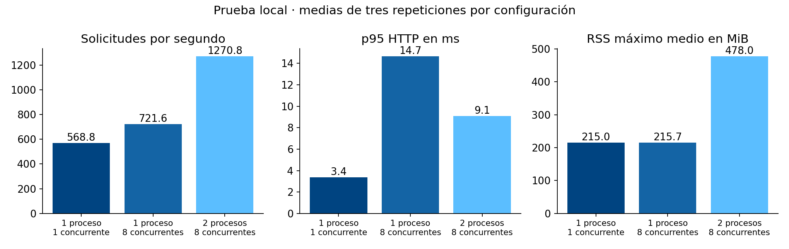
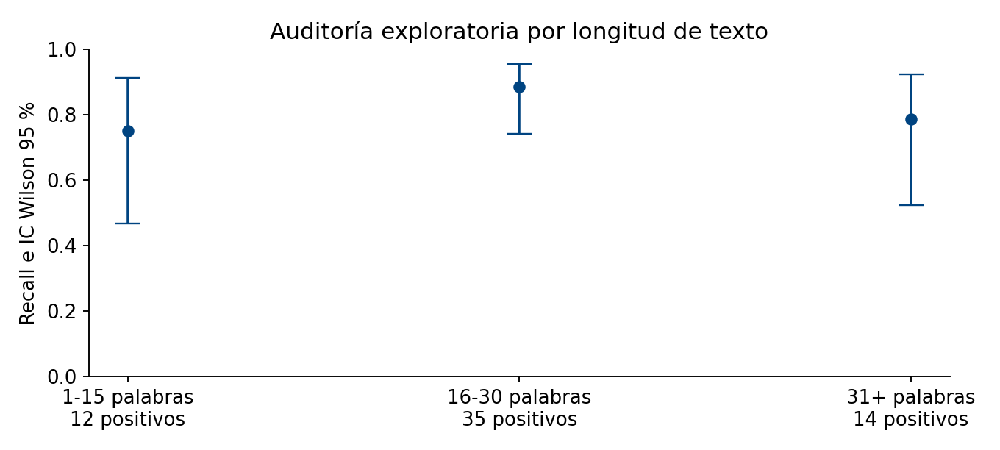

# Anexo técnico · Costos, desempeño y fairness

**Eduardo Aburto Angulo · Actividad 9**

[Portada](../../README.md) · [Índice documental](../README.md)

Edición de lectura revisada el 21 de noviembre de 2026. Las mediciones y tarifas conservan la fecha y alcance de la evidencia original; esta revisión no constituye una nueva corrida.

## Contenido

- [Declaración de Uso de Inteligencia Artificial](#seccion-1)
- [Desarrollo de Contenido](#seccion-2)
- [Cómo verificar este anexo](#seccion-3)
- [Resultados completos de rendimiento](#seccion-4)
- [Métricas de desempeño por dimensión](#seccion-5)
- [Latencia (p50, p95, p99)](#seccion-6)
- [Throughput (solicitudes por segundo)](#seccion-7)
- [Uso de recursos (CPU y memoria)](#seccion-8)
- [Costeo reproducible y sensibilidad](#seccion-9)
- [Alcance y comparación con Fase I](#seccion-10)
- [Fase I y dimensionamiento del negocio](#seccion-11)
- [Calidad y evaluación exploratoria de fairness](#seccion-12)
- [Lotes y controles operativos](#seccion-13)
- [Conclusiones](#seccion-14)
- [Cobertura de la rúbrica](#seccion-15)
- [Fuentes y reproducibilidad](#seccion-16)
- [Referencias](#seccion-17)

ACTIVIDAD 9

Anexo técnico de desempeño costos y gobernanza

Vértice AI Consulting  ·  Convertimos datos en decisiones

| Materia: | Gestión de Proyectos de Inteligencia Artificial |
| --- | --- |
| Actividad: | Actividad 9 · Módulo 3 / Semana 11 · Temas 21 y 22 |
| Alumno(a): | Eduardo Aburto Angulo |
| Matrícula: | AL07182743 |
| Docente: | M. en C. Luis Ariel Vázquez Piña |
| Fecha de entrega: | 8 de noviembre de 2026 |

## Declaración de Uso de Inteligencia Artificial

El alumno debe indicar de manera honesta si utilizó herramientas de Inteligencia Artificial (IA) para el desarrollo de esta actividad. Completa la siguiente tabla:

| Herramienta de IA utilizada | ¿La usaste? | Propósito / Descripción de uso |
| --- | --- | --- |
| ChatGPT / OpenAI | Sí | ChatGPT/Codex: apoyo en programación, pruebas locales, investigación de fuentes públicas, documentación y revisión visual. Distingo mediciones reales de escenarios y propuestas. |
| Claude (Anthropic) | Sí | Revisión técnica independiente de la entrega: clonado del repositorio, ejecución propia de las 11 pruebas automatizadas y de `scripts/verify.py` —que confirma el modelo conservado, las 40,680 solicitudes, las nueve mediciones y el bloqueo productivo—; verificación del SHA256 del modelo contra el manifiesto y la cadena Actividad 6 → Fase II → Actividad 8; cotejo de los entregables contra los cuatro criterios de la rúbrica y los apartados exigidos; y elaboración de las instrucciones de corrección. No redactó el código ni los documentos. |
| Gemini (Google) | No | No utilizada en la ejecución de la Actividad 9. |
| Copilot (Microsoft) | No | No utilizada en la ejecución de la Actividad 9. |
| Otra (especifica): | No | No utilizada en la ejecución de la Actividad 9. |

## Desarrollo de Contenido

## Cómo verificar este anexo

Este anexo separa mediciones locales, supuestos económicos y controles pendientes. Los archivos JSON y CSV son la fuente de las tablas. scripts/verify.py recalcula métricas, p95, throughput, costos, integridad del modelo y bloqueo productivo; no genera una nueva carga. Los scripts de experimentación permiten repetir los ensayos en otro equipo, con tiempos que pueden variar.

| Archivo | Origen y alcance |
| --- | --- |
| benchmark_requests.csv | 40,680 respuestas HTTP; identificadores y latencia por solicitud |
| benchmark.json | Nueve resúmenes, plataforma y condiciones del ensayo |
| fairness.json | Calidad y segmentos retrospectivos del test de 452 noticias |
| batching.json | Cinco repeticiones por tamaño offline 1, 32 y 128 |
| costos.json | Cálculo determinista desde config/costs.json |
| governance_gate.json | Cinco aprobaciones pendientes y producción bloqueada |

Se preservó un intento fallido de carga con conexiones nuevas que agotó puertos efímeros del cliente. Después se corrigió con sesiones persistentes por hilo y se repitió todo. intentos_benchmark.json distingue ese problema de un fallo del modelo. Sólo las nueve repeticiones completas integran los resultados.

## Resultados completos de rendimiento

| P / C / rep | rps | p95 ms | RSS MiB | CPU núcleos |
| --- | --- | --- | --- | --- |
| 1/1/1 | 574.17 | 3.352 | 226.59 | 0.686 |
| 1/1/2 | 567.53 | 3.517 | 209.16 | 0.687 |
| 1/1/3 | 564.71 | 3.263 | 209.20 | 0.689 |
| 1/8/1 | 722.18 | 14.632 | 227.28 | 1.032 |
| 1/8/2 | 720.71 | 14.670 | 209.84 | 1.035 |
| 1/8/3 | 721.87 | 14.697 | 209.84 | 1.036 |
| 2/8/1 | 1287.10 | 8.737 | 498.73 | 1.979 |
| 2/8/2 | 1269.07 | 8.878 | 473.69 | 1.978 |
| 2/8/3 | 1256.21 | 9.614 | 461.53 | 1.955 |

P significa procesos y C concurrencia del cliente. CPU 1.0 equivale a un núcleo ocupado. Cada fila contiene 4,520 solicitudes exitosas; el máximo cambio de probabilidad es 1.11 × 10⁻¹⁶, atribuible a precisión numérica. No se midió escalado horizontal entre servidores.

Throughput = solicitudes completadas / segundos transcurridos. p95 = percentil 95 de tiempos cliente HTTP por repetición. Reporto media de los tres p95 al resumir, no un p95 combinado. RSS es el máximo muestreado de la suma de procesos del servidor; puede duplicar memoria compartida.

Figura 1. Comparación local. Tres repeticiones cortas no reemplazan prueba de estabilidad.

## Métricas de desempeño por dimensión

## Latencia (p50, p95, p99)

| Procesos / concurrencia / rep | p50 ms | p95 ms | p99 ms |
| --- | --- | --- | --- |
| 1/1/1 | 1.557 | 3.352 | 4.278 |
| 1/1/2 | 1.581 | 3.517 | 4.221 |
| 1/1/3 | 1.597 | 3.263 | 4.248 |
| 1/8/1 | 10.866 | 14.632 | 19.227 |
| 1/8/2 | 11.004 | 14.670 | 16.930 |
| 1/8/3 | 11.051 | 14.697 | 16.739 |
| 2/8/1 | 5.989 | 8.737 | 10.587 |
| 2/8/2 | 6.074 | 8.878 | 10.450 |
| 2/8/3 | 6.115 | 9.614 | 11.431 |

Percentiles cliente HTTP de cada repetición completa; no incluyen warmup ni red externa. El p99 refleja la cola observada en una prueba corta, no un compromiso contractual.

## Throughput (solicitudes por segundo)

| Procesos / concurrencia | Media solicitudes/s | Lectura |
| --- | --- | --- |
| 1/1 | 568.80 | Media de tres repeticiones locales |
| 1/8 | 721.59 | Media de tres repeticiones locales |
| 2/8 | 1270.80 | Media de tres repeticiones locales |

Cada corrida divide sus 4,520 respuestas entre su duración. No extrapolo estas tasas de ráfaga a demanda mensual sostenida. El objetivo cloud de 10 solicitudes/s por una hora sigue sin validar.

## Uso de recursos (CPU y memoria)

| Procesos / concurrencia | CPU observada, núcleos equivalentes | RSS observado, MiB |
| --- | --- | --- |
| 1/1 | 0.687 | 214.98 |
| 1/8 | 1.035 | 215.66 |
| 2/8 | 1.971 | 477.98 |

Los valores son medias de CPU total y de picos RSS de los procesos servidor en un host con 10 CPU lógicas y 16 GiB. No se aislaron recursos ni se midió memoria por réplica cloud; no reparto artificialmente el agregado entre procesos. La suma RSS puede duplicar páginas compartidas.

| Aprovisionamiento propuesto por réplica | CPU | Memoria GiB | Estado |
| --- | --- | --- | --- |
| Base cloud simulada | 2 | 4 | Sin medición con cuotas |
| Rediseño y piloto | 1 | 1 | Sin medición por réplica cloud |

Comparar recursos observados y aprovisionados orienta el ensayo futuro, pero no prueba que una réplica de 1 CPU sostenga la concurrencia objetivo. Debo medir saturación, memoria y latencia con límites efectivos antes de aprobar el cambio.

## Costeo reproducible y sensibilidad

API USD = 3600 × horas instancia × (CPU × 0.000018 + GiB × 0.000002). Horas instancia = mínimas × 730 + extras × horas pico. Infraestructura = API + frontend + 10 + 5. TCO = infraestructura + 8 × 40. Esta tabla se expresa en USD; la conversión a MXN y su fuente se presentan en el apartado de Fase I.

| Escenario | Horas API | API USD | Infra USD | TCO USD |
| --- | --- | --- | --- | --- |
| Base cloud simulada | 1460 | 231.26 | 296.20 | 616.20 |
| Rediseño estable | 1460 | 105.12 | 170.05 | 490.05 |
| Rediseño con picos | 1540 | 110.88 | 175.81 | 495.81 |
| Límite seis instancias todo el mes | 4380 | 315.36 | 380.29 | 700.29 |

| Escenario | 100 mil req | 1 millón req | 5 millones req |
| --- | --- | --- | --- |
| Base cloud simulada | 2.9620 | 0.2962 | 0.0592 |
| Rediseño estable | 1.7005 | 0.1701 | 0.0340 |
| Rediseño con picos | 1.7581 | 0.1758 | 0.0352 |
| Límite seis instancias todo el mes | 3.8029 | 0.3803 | 0.0761 |

La segunda tabla expresa USD por mil solicitudes, no costo total. Dividir por más solicitudes no demuestra que puedan atenderse con la misma configuración. No se han incluido gastos variables de salida de red, impuestos, licencias o soporte. El ahorro de 42.59 % se calcula sobre infraestructura, no sobre TCO ni sobre una factura real.

## Alcance y comparación con Fase I

## Fase I y dimensionamiento del negocio

La Fase I aporta el business case: 24 asesores con 150 clientes cada uno, 3,600 clientes y AUM simulado de $54,397 millones MXN. Preserva 7,200 revisiones al año y evaluación diaria de la cartera. Copio estas cifras del antecedente proporcionado por el autor; no recalculo su ROI.

Bajo treinta días y una inferencia por evaluación, dimensiono 108,000 evaluaciones mensuales. Una evaluación de cartera puede requerir varias noticias, o compartir noticias entre clientes: esa relación debe medirse en el piloto. Las revisiones anuales son un proceso humano distinto y no se suman como inferencias.

| Escenario de solicitudes | Relación con Fase I | Uso |
| --- | --- | --- |
| 100,000 | Aproximación al alcance de 108,000; no equivalencia exacta | Referencia inicial de costo unitario |
| 1,000,000 | 9.26 veces el alcance (aproximadamente diez) | Crecimiento regional hipotético |
| 5,000,000 | 46.30 veces el alcance | Techo de escenario, no capacidad demostrada |

La infraestructura estable de USD 170.05/mes equivale a MXN 3,168.02/mes y MXN 38,016.21/año al FIX de 18.6297 del 6 de noviembre de 2026 (Banco de México). Representa 0.797 % de los MXN 4,769,996 anuales de operación de Fase I y MXN 0.8800 por cliente al mes. Comparo un componente NLP con el presupuesto integral; no afirmo que lo sustituya ni que la diferencia sea ahorro realizable.

Conservo inversión de piloto de MXN 9,083,448, beneficio anual esperado a plena operación de MXN 40,540,443, ROI a tres años de 298.6 % y recuperación en mes 13. El caso conservador conserva 38.8 % y mes 25. Por cada peso de corretaje, el cliente conserva $1.04 según Fase I; el umbral de rotación es 3.0 puntos porcentuales por encima del 2 % de costo. Son hipótesis del business case, no resultados de esta prueba.

La Actividad 9 dimensiona infraestructura; no valida que el ROI de 298.6 % se materialice. Lo mediré en el piloto con seis asesores de los meses 1 a 9. Propongo dos réplicas mínimas de 1 CPU/1 GiB y máximo dos en piloto en sombra; al aprobar el paso a 24 asesores, mantendría dos mínimas y permitiría hasta seis. Ambas configuraciones requieren ensayo cloud. Seis permanentes costarían USD 380.29 y excederían el presupuesto académico de USD 300.

## Calidad y evaluación exploratoria de fairness

| Grupo | n / positivos | TP / FN | FP / TN | TPR | FPR |
| --- | --- | --- | --- | --- | --- |
| 1-15 palabras | 134 / 12 | 9 / 3 | 6 / 116 | 0.7500 | 0.0492 |
| 16-30 palabras | 233 / 35 | 31 / 4 | 13 / 185 | 0.8857 | 0.0657 |
| 31+ palabras | 85 / 14 | 11 / 3 | 6 / 65 | 0.7857 | 0.0845 |

| Grupo | IC Wilson TPR 95 % | Selección | Precisión |
| --- | --- | --- | --- |
| 1-15 palabras | 0.4677 a 0.9111 | 0.1119 | 0.6000 |
| 16-30 palabras | 0.7405 a 0.9546 | 0.1888 | 0.7045 |
| 31+ palabras | 0.5241 a 0.9243 | 0.2000 | 0.6471 |

TPR = TP/(TP+FN), FPR = FP/(FP+TN), selección = (TP+FP)/n. Equal opportunity compara TPR; equalized odds compara TPR y FPR; paridad demográfica compara selección; paridad predictiva compara precisión. En esta muestra sólo exploro condiciones de longitud: no son resultados por colectivos protegidos ni una auditoría demográfica concluida.

Los grupos usan límites fijos de 15 y 30 palabras. Hay sólo 12, 35 y 14 positivos. La brecha TPR máxima de 0.1357 y su bootstrap descriptivo [0.0357, 0.4289] no constituyen una prueba de significancia confirmatoria. No reajusté el umbral a partir de estos resultados. Para la siguiente etapa predefiniré segmentos y muestra externa antes de evaluar.

Figura 2. Incertidumbre de recall por longitud.

## Lotes y controles operativos

| Lote | Textos por segundo media | ms amortizados por texto |
| --- | --- | --- |
| 1 | 1190.0 | 0.8403 |
| 32 | 18106.0 | 0.0552 |
| 128 | 29249.4 | 0.0342 |

Cinco repeticiones por tamaño y orden fijo, con posible calentamiento. El cronómetro incluye vectorización e inferencia, sin HTTP ni espera de cola. Todos los tamaños conservaron las probabilidades. Usaría lotes para preparación offline; no inferiría que un usuario recibe una respuesta en el tiempo amortizado.

| Puerta pendiente | Evidencia necesaria para evaluar |
| --- | --- |
| Licencia comercial | Autorización o sustitución del corpus y análisis del modelo derivado |
| Validación México y español | Test externo, revisión de etiquetas y métricas con incertidumbre |
| Privacidad y jurídico | Expediente de finalidad, aviso, seguridad y transferencias |
| Carga y failover cloud | Logs de carga sostenida, pérdida de réplica y recuperación |
| Fairness demográfica | Evaluación lícita con muestra suficiente o limitación de uso acordada |

La salida actual es production_authorized=false. Las pruebas automatizadas verifican bloqueos, integridad y controles económicos; no equivalen a una certificación ni a una auditoría legal externa.

## Conclusiones

El anexo permite contrastar latencia, throughput y uso de recursos observados con escenarios económicos y límites de fairness. Conservo las nueve corridas y el bloqueo productivo. Mi decisión es probar el dimensionamiento en nube antes de ampliar el piloto; las tablas de costos no sustituyen una factura ni una prueba de capacidad. Con ese ánimo, priorizo cerrar las brechas antes de asumir compromisos de servicio. La IA no sustituye el criterio del banquero; lo aumenta.

## Cobertura de la rúbrica

| Criterio | Apartado y evidencia |
| --- | --- |
| Arquitectura y escalabilidad | Latencia, throughput, uso de recursos y Arquitectura.pdf |
| Costos y FinOps | Costeo reproducible, Fase I y Anexo_tecnico.xlsx |
| Auditoría responsable | Fairness, intervalos, licencia y puertas pendientes |
| Plan integral | Controles operativos, conclusiones y criterios de aprobación |

## Fuentes y reproducibilidad

Entorno de medición: macOS ARM64, Python 3.12.14, diez CPU lógicas y 16 GiB. requirements.txt fija versiones. Para verificar: instalar dependencias, ejecutar pytest pruebas -q y python scripts/verify.py. Para repetir: python scripts/benchmark.py, python scripts/analyze.py, python scripts/costs.py y python scripts/governance.py. La nueva ejecución sobrescribe evidencias locales; conservar un commit antes de repetir.

El test y modelo se reutilizan con su atribución y licencia en modelos/LICENSE_DATASET.txt. No se usan clientes reales. El directorio contexto conserva la simulación de 150 personajes y las fuentes públicas de fondos como continuidad, separado del benchmark y del análisis de fairness.

## Referencias

Banco de México. (2026, 6 de noviembre). Tipo de cambio FIX [Serie diaria]. https://www.banxico.org.mx/apps/dao-web/4/52/Fix48.html

BBVA México. (s. f.). Normativa de fondos. https://www.bbva.mx/personas/productos/inversion/normativa-de-fondos.html

Beyer, B., Murphy, N. R., Rensin, D. K., Kawahara, K., & Thorne, S. (Eds.). (2018). The site reliability workbook: Practical ways to implement SRE. O’Reilly Media. https://sre.google/workbook/implementing-slos/

CNBV. (s. f.). Anexo 13 Conflictos de interés en servicios de inversión. https://www.cnbv.gob.mx/Anexos/Anexo%2013%20Entidades%20y%20personas.pdf

Comisión Europea. (s. f.). AI Act Article 2 Scope. https://ai-act-service-desk.ec.europa.eu/en/ai-act/article-2

FinOps Foundation. (s. f.). FinOps Framework. https://www.finops.org/framework/

Gobierno de México. (2025). Ley Federal de Protección de Datos Personales en Posesión de los Particulares. https://www.ordenjuridico.gob.mx/Documentos/Federal/html/wo125102.html

Google Cloud. (s. f.). About instance autoscaling. https://docs.cloud.google.com/run/docs/about-instance-autoscaling

Google Cloud. (s. f.). Cloud Run pricing. Tarifas consultadas el 8 de noviembre de 2026. https://cloud.google.com/run/pricing

ISO. (2023). ISO/IEC 42001 Artificial intelligence management system. https://www.iso.org/standard/81230.html

Malo, P., Sinha, A., Korhonen, P., Wallenius, J., & Takala, P. (2014). Good debt or bad debt: Detecting semantic orientations in economic texts. Journal of the Association for Information Science and Technology, 65(4), 782–796. https://doi.org/10.1002/asi.23062

NIST. (2023). Artificial Intelligence Risk Management Framework AI RMF 1.0. https://nvlpubs.nist.gov/nistpubs/ai/NIST.AI.100-1.pdf

Universidad Tecmilenio. (2026). Temas 21 y 22 y rúbrica de la Actividad 9 [Material del curso].

Este documento fue estructurado precisamente para cubrir esos 4 apartados de forma explícita y verificable.

## Archivos de entrega

[PDF](../Anexo_tecnico.pdf) · [Word](../Anexo_tecnico.docx) · [Volver al índice](../README.md)
