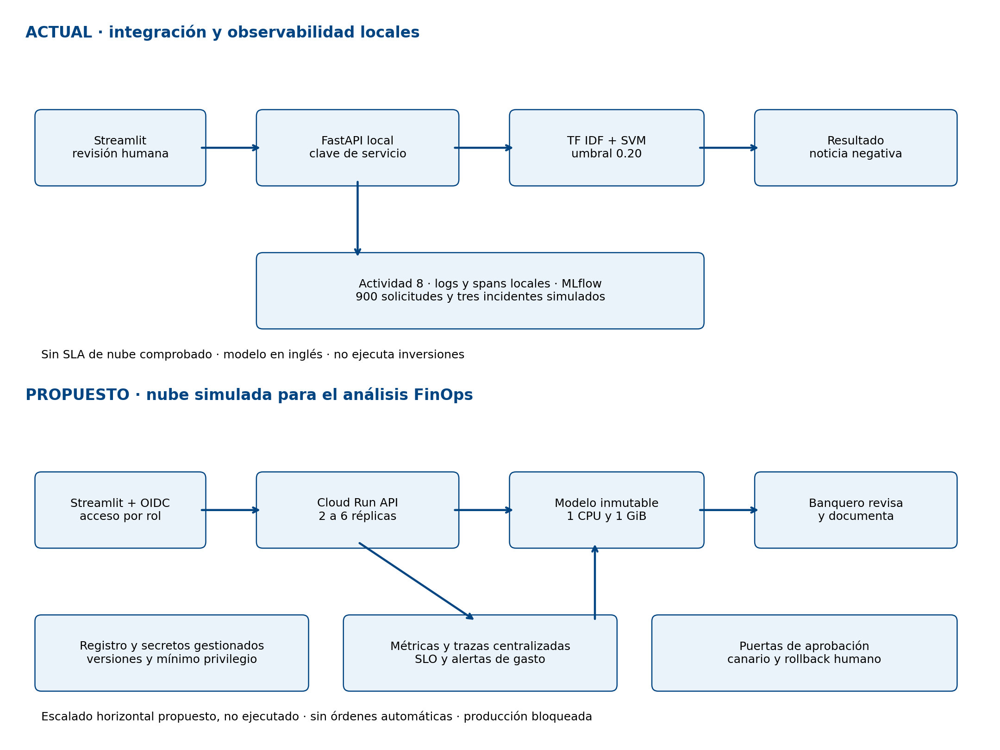

# Arquitectura actual y propuesta

[Portada](../../README.md) · [Índice documental](../README.md)

El sistema actual ejecuta la inferencia local. El rediseño propone Cloud Run y controles de gobernanza; no representa un despliegue productivo validado. Dos procesos en un host no equivalen a escalamiento horizontal en nube.

[Descargar PDF](../Arquitectura.pdf) · [Análisis técnico](../01-reporte-tecnico/README.md)
